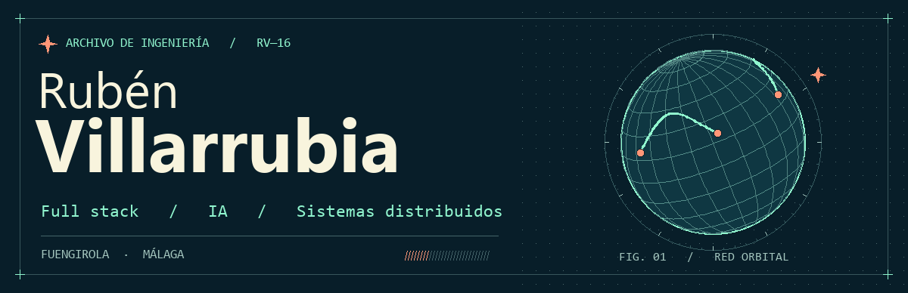
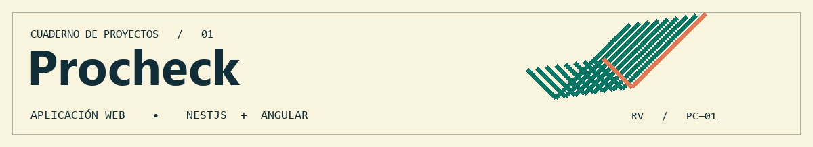

<picture>
  <source media="(prefers-reduced-motion: reduce)" srcset="./perfil-assets/atlas.png">
  
</picture>

**📍 Fuengirola, Málaga** &nbsp;·&nbsp; 🟢 Abierto a oportunidades profesionales

Desarrollo aplicaciones web de extremo a extremo. Trabajo con Angular en la interfaz y con NestJS o Spring Boot en el backend. Me interesa especialmente lo que ocurre entre servicios: cómo comparten datos y dónde un modelo de lenguaje puede aportar algo útil.

## ◈ Proyecto destacado

**Procheck** es una aplicación web que desarrollé en un entorno empresarial. La interfaz en **Angular** consume una API en **NestJS**; **TypeScript** es el lenguaje común a ambos lados.

[Explorar el código de Procheck →](https://github.com/rubenvg16/Procheck)

## ✦ Áreas de trabajo

🧠 **Inteligencia artificial** — Integro modelos de lenguaje y agentes en flujos de trabajo.  
🛰️ **Sistemas distribuidos** — Diseño APIs y organizo servicios en contenedores con Docker.  
🧩 **Desarrollo full stack** — Conecto lo que ve el usuario con la lógica y los datos que hay detrás.

## 🧰 Caja de herramientas

**01 / Backend**  

**02 / Frontend**  

**03 / Infraestructura y datos**  

---

✧ [Ver más proyectos](https://github.com/rubenvg16?tab=repositories)  ·  [Escribirme por correo](mailto:rubenvillarrubiagutierrez@gmail.com) ✧
